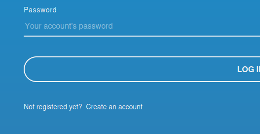
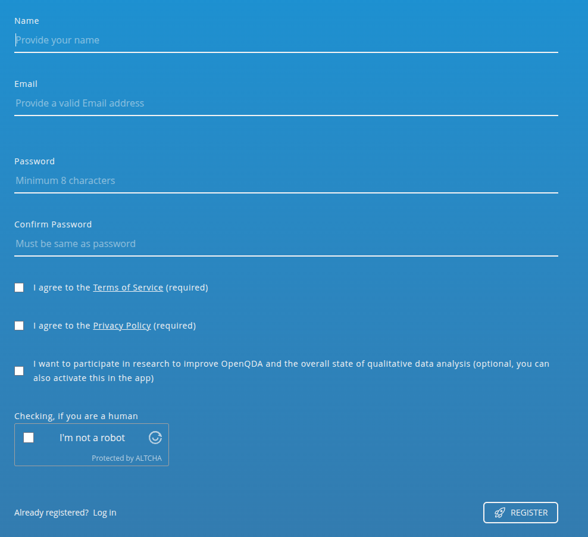
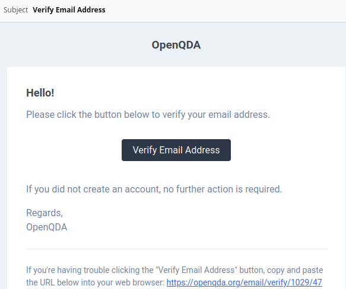

# Register a new account

Head over to [the OpenQDA website at openqda.org](https://openqda.org).
You will see the default login screen. Below the login form you will have the option
to create an account by clicking on "Create an account":

## Fill out the registration form
Now fill out the register form with your name or pseudonym, your email and a secure password.

::: tip
While currently it is only required that your password consists of a minimum of eight characters, 
we recommend using a password manager. 
If you do not use a password manager, then we recommend a mix of letters, numbers and special characters.
::: 
 
You will have to confirm that you read and accept the terms of service and privacy policy.
Optionally, you can [participate in our research](./research.md) by accepting the research consent.
If you are unsure, you can still decide later within the app.

You will also have to confirm that you are not a robot.
For this check **we are not** sending any data to third parties, because the [human verification tool](https://altcha.org)
is self-hosted on our servers.

## Verify your account

A verification email should have been sent to the email address you provided - please open it and click the link to 
verify your email address and complete the registration process.
Please also check the spam/junk folders to make sure you received the email in time.

::: tip
Check your spam or junk folders for any emails from OpenQDA.
If you still haven't received any email, also make sure your email address was written correctly.
:::

Now that you are verified, you can log into OpenQDA with your mail address and password and start using the software by
either editing your profile or creating a new project for data analysis.

