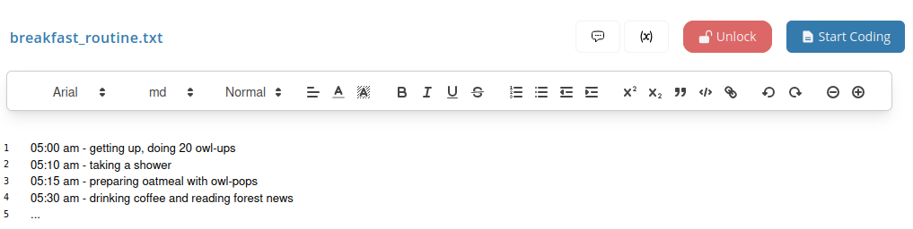
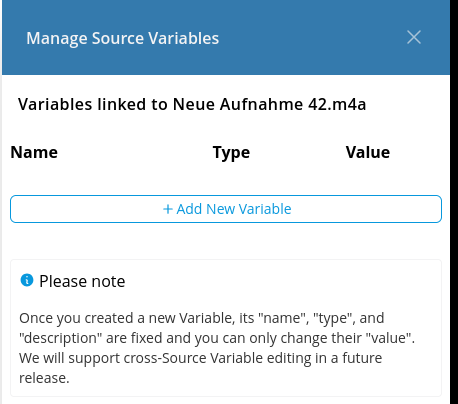
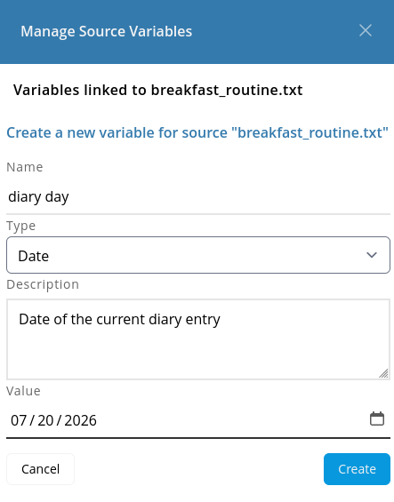
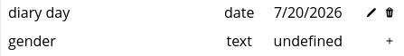
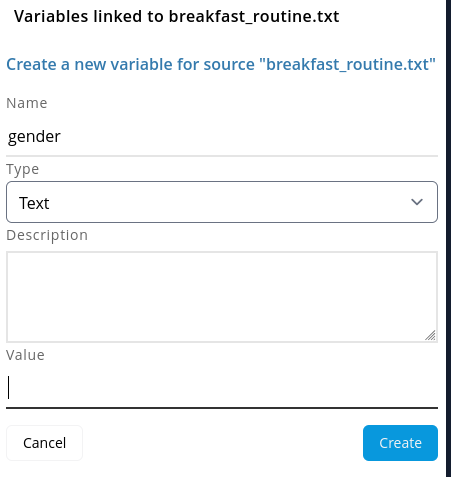
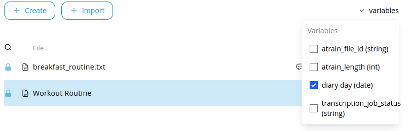
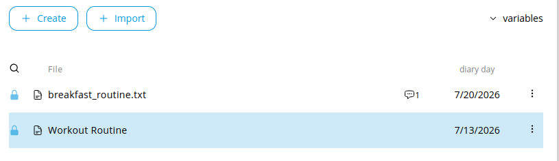

# Manage Source Variables

You can define custom Variables of various datatypes for your [Sources](./manage_sources.md).
Using Variables you can attach a certain level of metadata to your source and describe them
semantically.

We use the [REFI](../../refi.md) definition of Variables that includes the following datatypes:

| Type                  | Format                                                                                                                                        | Usage                                                                     |
|-----------------------|-----------------------------------------------------------------------------------------------------------------------------------------------|---------------------------------------------------------------------------|
| Boolean               | `true` or `false`                                                                                                                             | Use for dichotome classifications                                         |
| Date                  | standard date format without time values, displayed as your locale-based date format, for example: `2026-07-30`                               | Use to classify date based data, such as date of interview recording etc. |
| Date-Time             | standard date format but with explicitly required time component, displayed as your locale-based date format, for example: `2026-07-30T12:32` | Use to classify time based data, such as exact timestamps                 |
| Floating-Point Number | Standard floating point numbers, such as `0.5`                                                                                                | Use for numerical values                                                  |
| Integer               | Standard integer numbers, such as `-1`, `0`, `1`                                                                                              | Use for numerical values, categorical, or ordinal classifications         |
| Text                  | Any UTF-8 character sequence                                                                                                                  | Most free usage                                                           |

## Open Variable Management

In your preparations view, open a Source and click on the Button with the `(X)` icon to open the variables management
sidebar.

The variables management opens and lists all current defined variables for the currently opened Source.

## Create Variables

In your Variable Management, click on the "Add New Variable" button.

A form is revealed, where you have to select the data type (see table above) and enter the name, description and value
of th Variable.

::: warning
Variable names, types and description cannot be changed, once created.
Future versions may support this, though.
For now, only values can be changed after Variable creation.
Therefore, make sure to correctly define your variables in the first place.
:::

Click on the "Create" button to confirm the Variable creation.

## Create existing Variable in other Sources

If you have created a variable for a Source and open the Variables management in another Source,
then you will see it being listed with a little `+` icon next to it.

If you click on the plus icon, the form will open with Variable data prefilled, so you only need to enter
the required Variable value:

## View Variables

While your Variable management displays all Variables for the current Source, you can also show and compare 
Variables for all Sources in your Sources list on the left side.

For this, click on the `variables` link in the left panel to show all created Variables and select/deselect them.
This will change the list view to include Variables.

## Update Variables

Please, first note the following:

::: warning
Variable names, types and description cannot be changed, once created.
Future versions may support this, though.
For now, only values can be changed after Variable creation.
Therefore, make sure to correctly define your variables in the first place.
:::

To update a variable value, you can open the Variable management and look for the Variable in the list, then
click on the little pencil icon to edit the Variable value.

The form opens and allows you to edit the value of the Variable.
Click the "Update" button to confirm the new Variable value.

## Delete Variables

To delete a variable value, you can open the Variable management and look for the Variable in the list, then
click on the little trash icon to delete the Variable value.

It will ask you to confirm the deletion. Click on the "Delete" button to confirm.
